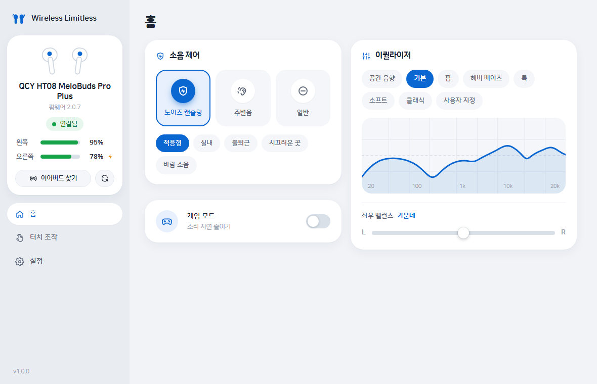

# Wireless Limitless

QCY 무선 이어버드를 **Windows PC에서** 제어하는 비공식 데스크톱 앱입니다.
휴대폰의 QCY 앱 없이 노이즈 캔슬링·이퀄라이저·터치 조작·기기 설정을 바꿀 수 있어요.

- 지원 모델: **QCY HT08 MeloBuds Pro Plus**, **QCY MeloBuds Pro** (펌웨어 2.0.7에서 검증)
- 요구 사항: Windows 10/11 (64비트), 블루투스 LE 지원 어댑터, Microsoft Edge WebView2 런타임(Windows 11 기본 포함)



## 설치

1. [Releases](https://github.com/jykim5215/wireless-limitless/releases/latest)에서 `WirelessLimitless-x.y.z-win64.zip`을 내려받아 압축을 풉니다.
2. `WirelessLimitless` 폴더의 **`install.cmd`** 를 더블클릭합니다.
   - `%LOCALAPPDATA%\Programs\WirelessLimitless`에 설치되고(관리자 권한 불필요)
   - 바탕화면과 시작 메뉴에 **Wireless Limitless** 바로가기가 생깁니다.
3. 이어버드를 케이스에서 꺼내면 앱이 자동으로 찾아 연결합니다.
   - 블루투스 LE로 직접 연결하므로 Windows에서 별도 페어링은 필요 없어요.
   - 휴대폰의 QCY 앱이 연결 중이면 PC가 연결하지 못할 수 있으니 앱을 닫아 주세요.

제거는 설치 폴더의 `uninstall.cmd`를 실행하세요.

## 기능

| 영역 | 기능 |
|---|---|
| 홈 | 노이즈 캔슬링(적응형·실내·출퇴근·시끄러운 곳·바람 소음, 강도 3단계), 주변음(음성 강조 / 레벨 1~6), 일반 · 이퀄라이저 프리셋 7종 + 사용자 지정 10밴드(±8dB) · 좌우 밸런스 · 게임 모드 |
| 터치 조작 | 왼쪽/오른쪽 × 1·2·3번 탭에 9가지 기능 지정 |
| 설정 | 착용 감지(+착용 시 소음 제어 복원), 수면 모드, 알림음 볼륨, 예약 전원 끄기, 연결 끊김 후 전원 끄기, LDAC, 듀얼 기기 연결, 이름 변경, 기본값 복원, 공장 초기화, 앱 업데이트 |
| 사이드바 | 배터리(좌/우/충전 중), 연결 상태, 이어버드 찾기, 다시 연결 |

펌웨어 업데이트(OTA)는 안전을 위해 지원하지 않습니다. QCY 공식 앱을 이용해 주세요.

## 업데이트

앱은 시작할 때(설정에서 끌 수 있음)와 **설정 › 앱 › 업데이트 확인**을 누를 때 이 저장소의 최신 Release를 확인합니다.
새 버전이 있으면 변경 사항을 보여 주고, 승인하면 내려받은 zip의 SHA-256을 검증한 뒤 스스로 교체하고 다시 실행합니다.
네트워크가 없거나 GitHub에 접속할 수 없으면 안내만 표시하고 지금 버전을 계속 사용합니다.

## 개발

```powershell
python -m venv .venv
.venv\Scripts\pip install -r requirements-dev.txt
$env:PYTHONPATH = "src"; .venv\Scripts\python -m wireless_limitless   # 소스로 실행
.venv\Scripts\python -m pytest                                        # 단위 테스트
powershell -ExecutionPolicy Bypass -File tools\build.ps1              # exe 빌드 + 배포 zip
```

- `tools/live_check.py` — 실기기 읽기 전용 점검 / `tools/live_write_test.py` — 실기기 쓰기 검증(끝나면 원래 값 복원)
- 프로토콜·구조·진행 상황은 [HANDOFF.md](HANDOFF.md), 보안 점검은 [SECURITY.md](SECURITY.md)를 참고하세요.

## 라이선스 / 고지

비공식 프로젝트이며 QCY와 무관합니다. 사용된 서드파티 구성 요소와 라이선스는 [THIRD_PARTY_NOTICES.md](THIRD_PARTY_NOTICES.md)에 있습니다.
